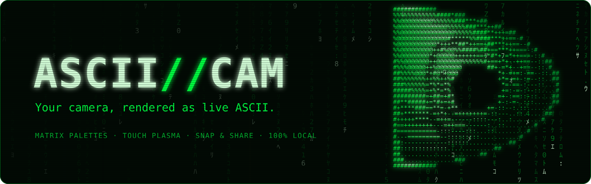

<p align="center">
  
</p>

# ASCII//CAM

Your camera, rendered as live ASCII art with Matrix-style palettes. Runs entirely in the browser.

- **Always in motion**: before the camera is on (or if access is denied) the screen shows an animated ASCII field with digital rain; when the camera starts, the image fades in from the noise.
- **Touch plasma**: moving the cursor or a finger over the screen leaves a glowing trail of scrambling characters, and every tap sends out a ripple, as if you were touching a plasma screen.
- **Palettes**: Matrix, Amber, Cyan, Neon and Paper, or your own background and character colours.
- **Settings**: character set (Matrix katakana, classic, detailed, blocks, binary), density, contrast, digital rain, CRT effect, invert and mirror. Saved in the browser.
- **Photos**: shutter button or Space bar. Share (Web Share API with files), download as PNG, or copy as plain ASCII text.
- **English and Spanish**: switch with the EN / ES toggle in the top-right corner.
- **Private**: frames never leave the device.

## Run locally

No dependencies and no build step. The camera needs a secure context (HTTPS or `localhost`):

```sh
python3 -m http.server 8000
# open http://localhost:8000
```

To try it on a phone, serve it over HTTPS (a tunnel, or GitHub Pages; see below).

## Deployment

`.github/workflows/pages.yml` checks the code on every push and pull request, and publishes `main` to GitHub Pages. Enable it once under **Settings → Pages → Source: GitHub Actions**.

## Banner

`assets/banner.svg` is generated by `scripts/banner.py`:

```sh
python3 scripts/banner.py
```
